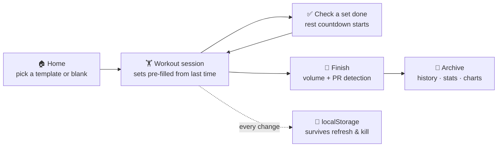

<div align="center">


# GymGym

**A local-first gym & body-weight tracker PWA — log every set, rest-timer built in, PRs detected automatically. Zero backend, zero accounts: your data never leaves your phone.**

[](https://mocas-12.github.io/gym-gym/)
[](https://react.dev)
[](https://github.com/pmndrs/zustand)
[](https://vitejs.dev)
[](https://mocas-12.github.io/gym-gym/)
[](./LICENSE)

**[🌐 Live Preview (GitHub Pages)](https://mocas-12.github.io/gym-gym/)**

**English** | [简体中文](./README.zh-CN.md)

*Safari → Share → Add to Home Screen → full-screen app → start training*

</div>

---

## 📖 Table of Contents

- [Features](#-features)
- [UI Design](#-ui-design)
- [How It Works](#-how-it-works)
- [Project Structure](#-project-structure)
- [Quick Start](#-quick-start)
- [Install on iPhone](#-install-on-iphone)
- [Apple Watch Roadmap](#-apple-watch-roadmap)
- [Tests](#-tests)
- [FAQ](#-faq)
- [Privacy & Security](#-privacy--security)
- [License](#-license)

## ✨ Features

- 📅 **Weekly plan / rotation**: assign a routine to each weekday, or run a rotation (A → B → C → A) that follows whatever you actually did; Home shows today's session and, on rest days, when the next one is
- 📈 **Progression engine**: linear and double-progression schemes auto-advance your working weights — hit all target reps → load goes up; miss → it doesn't; stall twice → deload. Every target shows *why* it is that number (openGym's core idea, rebuilt)
- 🔗 **Supersets**: pair adjacent exercises in the routine editor; the workout flags the pair and the rest-timer tells you to alternate
- 👆 **Swipe a set**: left to delete, right to copy — plus per-exercise rest override right on the workout screen
- 🏋️ **Guided sessions**: start from a preset routine (push / pull / legs / full-body) or a blank workout; add exercises from a 46-movement built-in library, searchable by muscle group and equipment
- 📋 **Weights auto-filled**: every exercise pre-fills the sets, reps and load you logged last time — no typing from scratch (inspired by openGym)
- ⏱️ **Rest timer**: checking a set done starts a countdown that floats above every screen; it beeps (WebAudio) and vibrates when time is up, with +30s and skip controls
- ☀️ **Screen stays awake**: the Wake Lock API keeps the display on while a workout is running
- 🏆 **PR detection**: on finish, every exercise's estimated 1RM (Epley) is compared against history; beating a past record gets flagged 🎉 — first-time exercises only set a baseline
- ⚖️ **Body weight**: daily log with a sparkline on Home and a full curve under History
- 📊 **History & stats**: monthly sessions / volume, per-exercise bests, expandable workout records with every set
- 💾 **One-tap backup**: export everything as a single JSON file, import it on any device
- 🈶 **Chinese-first UI** with a dark iOS-style theme
- 🔒 **Local-only**: no backend, no accounts, no telemetry — the entire state is one JSON document in `localStorage`

## 🎨 UI Design

| Element | Design |
| --- | --- |
| Theme | Near-black blue base (`#0c1015`) + lime accent (`#a3e635`), iOS system feel |
| Cards | Dark panels with hairline borders, 16px radius |
| Tab bar | Fixed bottom, frosted-glass blur, safe-area inset for notch devices |
| Rest timer | Floating gradient bar above the tab bar, tabular-num countdown |
| Picker | Bottom sheet with muscle-group sections, search, and one-tap custom exercise creation |
| Typography | `-apple-system` stack, tabular numerals for all numbers |

## 🧠 How It Works



1. **Single store**: one Zustand store holds the entire app state (`useStore.js`), persisted to `localStorage` through `zustand/middleware`. The active workout lives in the same document, so a refresh or force-kill never loses a set
2. **Set pre-fill**: `lib/workout.js → prefillFor()` walks the history backwards for the last logged sets of that exercise and copies them in as suggestions
3. **Rest timing**: the countdown stores a timestamp (not a ticking counter), so it stays correct across re-renders; completion triggers beeps via WebAudio and `navigator.vibrate`
4. **PR rules**: `lib/onerm.js` computes Epley estimated 1RM per set; a PR is only recorded when a past record exists and is beaten — a first-time exercise just sets the baseline
5. **Zero-dependency icons**: `scripts/gen-icons.mjs` hand-encodes PNGs (IHDR/IDAT/IEND + zlib) — no canvas or image library anywhere in the project
6. **Deploy**: `npm run deploy` builds and pushes `dist/` as an orphan commit to `gh-pages` via a temporary `GIT_INDEX_FILE`; GitHub Pages serves it at the root

## 📁 Project Structure

```text
gym-gym/
├── index.html               # iOS meta: standalone mode, status-bar style, safe-area viewport
├── logo.svg                 # Repo logo (also the app icon design)
├── public/
│   ├── manifest.webmanifest # PWA manifest (standalone, portrait, zh-CN)
│   └── icons/               # Generated PNGs: 192 / 512 / apple-touch 180
├── scripts/
│   ├── gen-icons.mjs        # Pure-Node PNG encoder → app icons
│   └── deploy.mjs           # Build + orphan-commit dist/ to gh-pages
├── src/
│   ├── main.jsx / App.jsx   # Hash-routed tabs: home / workout / history / settings
│   ├── store/
│   │   ├── useStore.js      # THE single store: all data + actions, persisted
│   │   └── useUI.js         # Ephemeral UI: rest countdown, toast, beep & vibrate
│   ├── data/
│   │   ├── exercises.js     # 46 built-in exercises (muscle / equipment / reps-time)
│   │   └── routines.js      # Presets: push / pull / legs / full-body
│   ├── lib/                 # Pure domain logic, each file unit-tested
│   │   ├── onerm.js         # Epley estimated 1RM
│   │   ├── workout.js       # finalize / volume / PR detection / set pre-fill
│   │   └── *.test.js
│   ├── components/          # TabBar / RestTimer / ExercisePicker
│   └── views/               # Home / WorkoutView / HistoryView / SettingsView
└── smoke.mjs                # Playwright end-to-end smoke (dev preview or live URL)
```

## 🚀 Quick Start

```bash
git clone https://github.com/Mocas-12/gym-gym.git
cd gym-gym
npm install
npm run dev
# Open http://localhost:5173/
```

| Command | Description |
| --- | --- |
| `npm run dev` | Vite dev server with hot reload |
| `npm test` | Vitest unit tests (1RM, volume, PR rules, pre-fill) |
| `npm run smoke` | Playwright end-to-end smoke (run `npm run build && npm run preview` first) |
| `npm run build` | Production build to `dist/` |
| `npm run icons` | Regenerate app icons from `logo.svg` geometry |
| `npm run deploy` | Build + publish to GitHub Pages (`gh-pages` branch) |

> Deployment is deliberately CI-free: `npm run deploy` pushes an orphan commit of `dist/` to the `gh-pages` branch, which the Pages source points at. Run it after every change and the live site updates.

## 📱 Install on iPhone

1. Open the [live site](https://mocas-12.github.io/gym-gym/) in Safari
2. Tap **Share → Add to Home Screen**
3. Launch from the home screen — it runs full-screen like a native app

Data lives in that home-screen app's own `localStorage`, which iOS **exempts from the 7-day eviction policy** that applies to ordinary Safari tabs. Export a JSON backup from Settings once in a while anyway — it costs two taps.

## 🍎 Apple Watch Roadmap

| Stage | Capability | Dependency |
| --- | --- | --- |
| Now | Workout / rest alerts mirrored to the watch as iOS notifications | Requires adding a small Web Push backend |
| Later | Native watchOS app (standalone timer & logging on the wrist) | Mac + Xcode, or GitHub Actions macOS runner + Sideloadly signing on Windows (7-day renewals) |

The data model is deliberately a single JSON document, so any future backend or watch app can adopt it without a migration.

## 🧪 Tests

Domain logic is covered by unit tests next to the code, and a Playwright smoke test walks the full user flow. Run locally:

```bash
npm test     # 7 unit tests: 1RM math, volume, PR rules, pre-fill
npm run smoke
```

The smoke script drives a 390×844 (iPhone) viewport through: render home → start a preset workout → check a set done (rest bar appears) → add an exercise via the picker → finish → verify history — and fails on any console or page error.

## ❓ FAQ

<details>
<summary><b>Will I lose my data when I switch phones?</b></summary>

- Not if you export first: Settings → <b>Export backup</b> produces one JSON file with everything; import it on the new device. No account means no automatic transfer — that is the trade-off of being server-free
</details>

<details>
<summary><b>Does iOS ever clear the stored data?</b></summary>

- Ordinary Safari tabs can have their storage evicted after 7 days of non-use, but a home-screen PWA is exempt. Still, the export button exists — use it
</details>

<details>
<summary><b>Why is there no cloud sync / accounts?</b></summary>

- By design: the whole point is zero servers and zero sign-ups. The data model (one JSON document per profile) is kept deliberately simple so that an optional sync backend — revision-based, field-merge, openGym-style — can be added later without migrating anything
</details>

<details>
<summary><b>Does it work on Android or desktop?</b></summary>

- Yes — any modern browser. The layout is tuned for iPhone-sized screens first; on desktop the tab bar is centered and the content column is capped at 560px
</details>

<details>
<summary><b>How do timed exercises (plank, cardio) work?</b></summary>

- Exercises marked <code>type: time</code> reuse the same set row: the weight column takes seconds, the reps column takes speed/pace. PR detection skips them (no meaningful 1RM)
</details>

## 🔒 Privacy & Security

- 🏋️ All data lives in your browser's `localStorage` — **never uploaded, never routed through any server**
- 🚫 The app makes **zero network requests** at runtime: no analytics, no CDN calls, no accounts, no tracking
- 📦 Backups are manual JSON downloads you keep yourself
- 🔑 Nothing to sign up for, nothing to log into, nothing to leak

## 📄 License

This project is open-sourced under the [MIT](./LICENSE) license — free to use, modify and redistribute (commercial use included), as long as the copyright and license notice are kept in your copy.

---

<div align="center">

**GymGym** · built local-first, inspired by the architecture of [openGym](https://github.com/DuarteSantos8/openGym)

</div>
