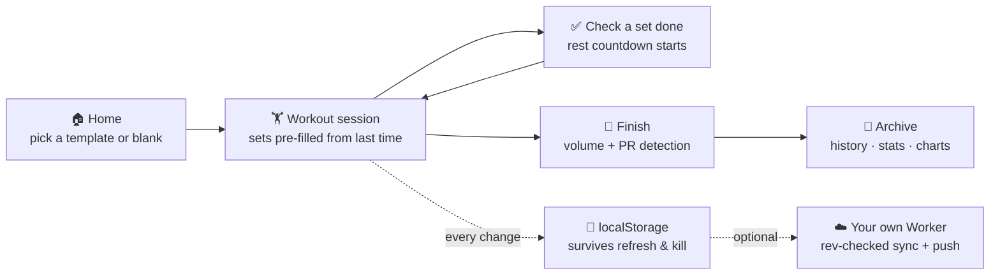

<div align="center">


# GymGym

**A local-first gym & body-weight tracker PWA — log every set, progressive overload built in, PRs detected automatically. Your data stays on your phone by default; optional self-hosted sync & push if you ever want it.**

[](https://github.com/Mocas-12/gym-gym/actions/workflows/ci.yml)
[](https://mocas-12.github.io/gym-gym/)
[](./lighthouserc.json)
[](https://react.dev)
[](https://github.com/pmndrs/zustand)
[](https://vitejs.dev)
[](https://mocas-12.github.io/gym-gym/)
[](./LICENSE)

**[🌐 Live Preview (GitHub Pages)](https://mocas-12.github.io/gym-gym/)**

**English** | [简体中文](./README.zh-CN.md)

*Safari → Share → Add to Home Screen → full-screen app → start training*

</div>

---

## 📖 Table of Contents

- [Features](#-features)
- [UI Design](#-ui-design)
- [How It Works](#-how-it-works)
- [Project Structure](#-project-structure)
- [Quick Start](#-quick-start)
- [Install on iPhone](#-install-on-iphone)
- [Optional Sync & Push](#-optional-sync--push)
- [Apple Watch Roadmap](#-apple-watch-roadmap)
- [Tests](#-tests)
- [FAQ](#-faq)
- [Privacy & Security](#-privacy--security)
- [License](#-license)

## ✨ Features

- 📅 **Weekly plan / rotation**: assign a routine to each weekday, or run a rotation (A → B → C → A) that follows whatever you actually did; Home shows today's session and, on rest days, when the next one is
- 📈 **Progression engine**: five auto-progression schemes per routine — linear, double progression, Greyskull LP (bonus for strong AMRAPs), triple progression (reps → sets → load) and time-based for planks/cardio; missed reps never add load, stalls trigger a deload, and every target shows *why* it is that number
- 🗺️ **Muscle map**: an anatomical body map colors 18 regions by training load, recovery status, or neglect — spot your blind spots before they become imbalances
- 🧮 **Plate math**: barbell entries show the per-side plate breakdown for your bar and the plates you own
- 💪 **RIR effort marking**: optionally record reps-in-reserve per set (R0 = failure), shown in history
- 🔗 **Supersets**: pair adjacent exercises in the routine editor; the workout flags the pair and the rest-timer tells you to alternate
- 👆 **Swipe a set**: left to delete, right to copy — plus per-exercise rest override right on the workout screen
- ✏️ **Edit & backfill history**: fix a past workout's date, sets or exercises, or log a session you did on paper — volume and PRs are re-read from the corrected history
- 🔥 **Warm-up sets**: tap a set number to mark it as warm-up; it stays in the log but is excluded from volume, PRs, 1RM and recovery stats
- 🎯 **Weight goal**: set a target body weight and the chart draws the goal line with remaining distance
- 🏋️ **Guided sessions**: start from a preset routine (push / pull / legs / full-body) or a blank workout; 115 built-in exercises across 8 muscle groups and 5 equipment types, with equipment filters and search — plus one-tap custom exercises
- 📋 **Weights auto-filled**: every exercise pre-fills the sets, reps and load you logged last time — no typing from scratch (inspired by openGym)
- ⏱️ **Rest timer**: checking a set done starts a countdown that floats above every screen; it beeps (WebAudio) and vibrates when time is up, with +30s and skip controls — and it can push the alert to your phone/watch even when the page is frozen (optional backend)
- ☀️ **Screen stays awake**: the Wake Lock API keeps the display on while a workout is running
- 🏆 **PR detection**: on finish, every exercise's estimated 1RM (Epley) is compared against history; beating a past record gets flagged 🎉 — first-time exercises only set a baseline
- ⚖️ **Body weight**: daily log with a sparkline on Home and a full curve under History
- 📊 **History & stats**: per-exercise estimated-1RM curves, a year-long GitHub-style training heatmap, monthly sessions / volume, per-exercise bests, expandable workout records
- 💾 **One-tap backup**: export everything as a single JSON file, import it on any device
- ☁️ **Optional sync & push**: connect your own tiny Cloudflare Worker for multi-device sync and Web Push rest alerts ([docs/SYNC_PUSH.md](./docs/SYNC_PUSH.md)) — plus built-in diagnostics that report crashes and Service-Worker status to that same backend so stale-device mysteries are one tap away
- 🈶 **Chinese-first UI** with a dark iOS-style theme
- 🔒 **Local-first**: no accounts, no third-party servers — the entire state is one JSON document in `localStorage`

## 🎨 UI Design

| Element | Design |
| --- | --- |
| Theme | Near-black blue base (`#0c1015`) + lime accent (`#a3e635`), iOS system feel |
| Cards | Dark panels with hairline borders, 16px radius |
| Tab bar | Fixed bottom, frosted-glass blur, safe-area inset for notch devices |
| Rest timer | Floating gradient bar above the tab bar, tabular-num countdown |
| Muscle map | Front/back body SVG, lime heat scale shared with the training heatmap |
| Picker | Bottom sheet with muscle-group sections, search, and one-tap custom exercise creation |
| Typography | `-apple-system` stack, tabular numerals for all numbers |

## 🧠 How It Works



1. **Single store**: one Zustand store holds the entire app state (`useStore.js`), persisted to `localStorage` through `zustand/middleware`. The active workout lives in the same document, so a refresh or force-kill never loses a set
2. **Set pre-fill**: `lib/workout.js → prefillFor()` walks the history backwards for the last logged sets of that exercise and copies them in as suggestions
3. **Progression**: `lib/progression.js` decides the next target with two iron rules borrowed from openGym — never add load on missed reps, and stall twice → deload instead of pushing through
4. **Rest timing**: the countdown stores a timestamp (not a ticking counter), so it stays correct across re-renders; completion triggers beeps via WebAudio and `navigator.vibrate`
5. **PR rules**: `lib/onerm.js` computes Epley estimated 1RM per set; a PR is only recorded when a past record exists and is beaten — a first-time exercise just sets the baseline
6. **Dirty-data defense**: every write path (storage rehydrate, remote adopt, import, server PUT) funnels through `lib/normalize.js`, so a malformed record can never crash the history view again
7. **Optional sync**: push carries a `baseRev`; on conflict (409) the document with the later edit wins. Sync is off until you connect it, and the app works fully offline either way

## 📁 Project Structure

```text
gym-gym/
├── index.html               # iOS meta: standalone mode, status-bar style, CSP, safe-area viewport
├── eslint.config.js         # ESLint 10 flat config (+ Prettier / tsconfig for lib type-checking)
├── lighthouserc.json        # Lighthouse CI: perf / a11y / best-practices / SEO gates
├── public/
│   ├── sw.js                # Hand-written service worker: nav network-first, assets cache-first
│   ├── manifest.webmanifest # PWA manifest (standalone, portrait, zh-CN)
│   └── icons/               # Generated PNGs: 192 / 512 / apple-touch 180
├── scripts/
│   ├── gen-icons.mjs        # Pure-Node PNG encoder → app icons
│   ├── inject-precache.mjs  # Injects the hashed-asset manifest into sw.js after build
│   ├── deploy.mjs           # Build + orphan-commit dist/ to gh-pages
│   └── deploy-backend.mjs   # Extract the Worker from docs/SYNC_PUSH.md → wrangler deploy
├── backend/
│   ├── wrangler.toml        # Optional micro-backend config (KV binding, origins, VAPID)
│   └── worker.test.js       # Full-chain tests: sync, RFC 8291 round-trip, rate limits, diagnostics
├── docs/SYNC_PUSH.md        # Optional sync/push guide + the Worker source (single source of truth)
├── src/
│   ├── main.jsx / App.jsx   # Hash-routed tabs: home / workout / plan / history / settings
│   ├── store/
│   │   ├── useStore.js      # THE single store: all data + actions, persisted
│   │   └── useUI.js         # Ephemeral UI: rest countdown, toast, beep & vibrate
│   ├── data/
│   │   ├── exercises.js     # 115 built-in exercises (8 muscle groups × 5 equipment types)
│   │   ├── exercise-regions.js # Per-exercise primary/secondary muscle-region annotations
│   │   └── body-paths.json  # Anatomy SVG paths for the muscle map (see NOTICE.md)
│   ├── lib/                 # Pure domain logic, JSDoc-typed and unit-tested
│   │   ├── workout.js       # finalize / volume / PR detection / set pre-fill
│   │   ├── progression.js   # Five progression schemes with reasons
│   │   ├── insights.js      # 1RM series / heatmap / muscle load & recovery
│   │   ├── muscles.js       # Muscle-map data layer (region weights, 3 color modes)
│   │   ├── plates.js        # Barbell plate math
│   │   ├── sync.js          # Optional backend client (sync / push / diagnostics)
│   │   ├── telemetry.js     # Crash capture + SW status self-report (sync-connected only)
│   │   ├── types.js         # Shared JSDoc typedefs (@ts-check)
│   │   └── *.test.js
│   ├── components/          # TabBar / RestTimer / ExercisePicker / BodyMap / ErrorBoundary / ...
│   └── views/               # Home / WorkoutView / PlanView / HistoryView / SettingsView / SyncCard
├── e2e-full.mjs             # Playwright E2E matrix: 46 checks × Chromium/WebKit
└── smoke.mjs                # Quick Playwright smoke against dev preview or the live URL
```

## 🚀 Quick Start

```bash
git clone https://github.com/Mocas-12/gym-gym.git
cd gym-gym
npm install
npm run dev
# Open http://localhost:5173/
```

| Command | Description |
| --- | --- |
| `npm run dev` | Vite dev server with hot reload |
| `npm test` | 73 unit tests (domain logic + the optional Worker) |
| `npm run test:coverage` | Unit tests + coverage gate (lib layer ≥ 85%) |
| `npm run lint` / `npm run format` | ESLint / Prettier |
| `npm run typecheck` | Strict JSDoc type-check over `src/lib` |
| `npm run build` | Production build to `dist/` (+ SW precache manifest) |
| `npm run deploy` | Build + publish to GitHub Pages (`gh-pages` branch) |
| `npm run backend:deploy` | Deploy the optional sync/push Worker ([docs/SYNC_PUSH.md](./docs/SYNC_PUSH.md)) |

CI runs on every push: lint → format check → typecheck → coverage gate → build → Lighthouse audit (perf / a11y / best-practices / SEO, all required at high scores). Publishing stays deliberately simple: `npm run deploy` pushes an orphan commit of `dist/` to the `gh-pages` branch that Pages serves.

## 📱 Install on iPhone

1. Open the [live site](https://mocas-12.github.io/gym-gym/) in Safari
2. Tap **Share → Add to Home Screen**
3. Launch from the home screen — it runs full-screen like a native app

Data lives in that home-screen app's own `localStorage`, which iOS **exempts from the 7-day eviction policy** that applies to ordinary Safari tabs. Export a JSON backup from Settings once in a while anyway — it costs two taps.

## ☁️ Optional Sync & Push

GymGym works fully offline by default. If you want more, deploy your own micro-backend (a single Cloudflare Worker + KV, free tier) to get:

- **Multi-device sync** — one JSON document per profile, revision-checked writes, conflict-safe
- **Web Push rest alerts** — the rest-timer notification reaches your phone (and mirrors to Apple Watch) even when the page is frozen in the background
- **Diagnostics** — connected clients report crashes and Service-Worker/cache status to *your* backend; the Sync card in Settings shows what's actually running on each device

Everything is Bearer-token authenticated and lives in your own Cloudflare account. Setup takes ~10 minutes: [docs/SYNC_PUSH.md](./docs/SYNC_PUSH.md).

## 🍎 Apple Watch Roadmap

| Stage | Capability | Status |
| --- | --- | --- |
| Now | Workout / rest alerts mirrored to the watch as iOS notifications | Works — enable push via the optional backend above |
| Later | Native watchOS app (standalone timer & logging on the wrist) | Mac + Xcode, or GitHub Actions macOS runner + TestFlight |

The data model is deliberately a single JSON document, so any future backend or watch app can adopt it without a migration.

## 🧪 Tests

```bash
npm test                # 73 unit tests — domain logic (1RM, volume, PR, progression,
                        # heatmap, muscle map, plates, plans) + the Worker (sync,
                        # RFC 8291 push round-trip, rate limits, diagnostics)
npm run test:coverage   # + coverage gate: src/lib ≥ 85% statements/branches/functions/lines
node e2e-full.mjs       # 46-check E2E matrix × Chromium & WebKit (build + preview first)
npm run smoke           # quick Playwright smoke
```

The E2E matrix walks every view — guided workouts, plan editing, history editing, settings — plus dirty-data resilience, offline rendering through the service worker, the v1→v4 migration chain, 300-record performance, and iPhone SE / 15 Pro Max / desktop layout checks. Any console or page error fails the run. `src/lib` is strictly JSDoc-typed (`npm run typecheck`) and Lighthouse CI audits the production build on every push.

## ❓ FAQ

<details>
<summary><b>Will I lose my data when I switch phones?</b></summary>

- Not if you export first: Settings → <b>Export backup</b> produces one JSON file with everything; import it on the new device. Or connect the optional sync backend and both devices converge automatically
</details>

<details>
<summary><b>Does iOS ever clear the stored data?</b></summary>

- Ordinary Safari tabs can have their storage evicted after 7 days of non-use, but a home-screen PWA is exempt. Still, the export button exists — use it
</details>

<details>
<summary><b>Do I need the backend?</b></summary>

- No. The app is fully functional offline, forever. The optional Worker adds multi-device sync, push alerts and diagnostics — and it's <i>your</i> deployment (one Worker + one KV namespace on the free tier), not someone else's service
</details>

<details>
<summary><b>Does it work on Android or desktop?</b></summary>

- Yes — any modern browser. The layout is tuned for iPhone-sized screens first; on desktop the tab bar is centered and the content column is capped at 560px
</details>

<details>
<summary><b>How do timed exercises (plank, cardio) work?</b></summary>

- Cardio entries get minutes / speed / incline fields; timed exercises like planks take seconds. The progression engine's <i>time-based</i> scheme auto-increments the target hold. PR detection skips them (no meaningful 1RM)
</details>

## 🔒 Privacy & Security

- 🏋️ All data lives in your browser's `localStorage` by default — **never uploaded anywhere**
- 🚫 With sync off, the app makes **zero network requests**: no analytics, no CDN calls, no accounts, no tracking
- ☁️ With sync on, data goes only to the Worker **you** deployed under **your** Cloudflare account, authenticated with a Bearer token you control
- 🩺 Diagnostics (crash message/stack, app version, Service-Worker status) are reported **only** while sync is connected, to that same backend — they never contain training data. Disconnect to stop reporting
- 📦 Backups are manual JSON downloads you keep yourself
- 🔑 No sign-up, no third party, nothing to leak

## 📄 License

This project is open-sourced under the [MIT](./LICENSE) license — free to use, modify and redistribute (commercial use included), as long as the copyright and license notice are kept in your copy.

---

<div align="center">

**GymGym** · built local-first, inspired by the architecture of [openGym](https://github.com/DuarteSantos8/openGym)

</div>
