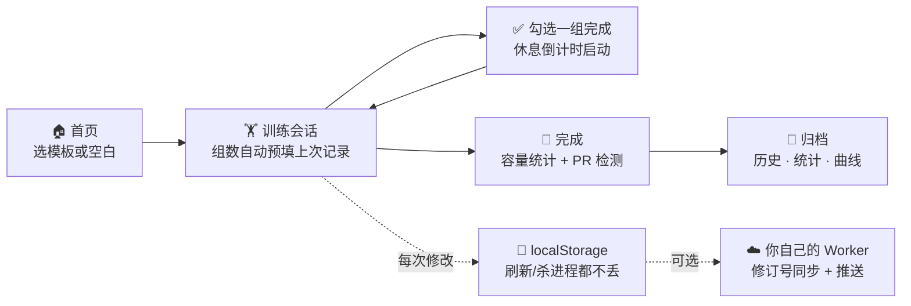

<div align="center">


# GymGym

**纯本地的健身与体重记录 PWA —— 记下每一组、渐进加重内置、PR 自动检测。默认数据不离开手机；想要多设备同步与推送时，连你自己部署的微后端即可。**

[](https://github.com/Mocas-12/gym-gym/actions/workflows/ci.yml)
[](https://mocas-12.github.io/gym-gym/)
[](./lighthouserc.json)
[](https://react.dev)
[](https://github.com/pmndrs/zustand)
[](https://vitejs.dev)
[](https://mocas-12.github.io/gym-gym/)
[](./LICENSE)

**[🌐 在线使用 (GitHub Pages)](https://mocas-12.github.io/gym-gym/)**

[English](./README.md) | **简体中文**

*Safari → 分享 → 添加到主屏幕 → 全屏 app → 开始训练*

</div>

---

## 📖 目录

- [功能](#-功能)
- [UI 设计](#-ui-设计)
- [工作原理](#-工作原理)
- [项目结构](#-项目结构)
- [快速开始](#-快速开始)
- [iPhone 安装](#-iphone-安装)
- [可选同步与推送](#-可选同步与推送)
- [Apple Watch 路线图](#-apple-watch-路线图)
- [测试](#-测试)
- [常见问题](#-常见问题)
- [隐私与安全](#-隐私与安全)
- [许可证](#-许可证)

## ✨ 功能

- 📅 **周计划 / 顺序轮换**：按星期几排课，或不看星期直接轮换（推→拉→腿→推…），首页显示今天练什么；休息日告诉你下一次是什么时候
- 📈 **渐进规则引擎**：五种自动方案可选——线性、双进程、Greyskull LP（末组冲刺双倍加重）、三进程（次数→组数→重量）、计时递增（平板支撑/有氧）；没做满绝不加重、连续停滞自动减载，每个目标都注明「为什么是这个数」
- 🗺️ **肌肉地图**：人体正/背面图按训练负荷、恢复进度或盲区给 18 个肌群分区着色——失衡趋势一眼看见
- 🧮 **杠铃配重**：杠铃动作按你的杆重和拥有的片规格，直接算出每边挂法
- 💪 **RIR 努力度**：每组可记力竭余力（R0=力竭），历史记录同步展示
- 🔗 **超级组**：模板编辑器里把相邻动作配成一对，训练时高亮分组、休息倒计时提醒你交替做
- 👆 **滑动操作**：一组左滑删除、右滑复制；训练页每个动作可独立改休息时长
- ✏️ **编辑/补记历史**：改过去某次训练的日期、组数或动作，或补记一次纸上练的——容量和 PR 会从修正后的历史重新读出
- 🔥 **热身组**：点组号标记热身，照常记录但不计入容量、PR、1RM 和恢复统计
- 🎯 **体重目标**：设定目标体重，曲线上画出目标线和剩余差距
- 🏋️ **引导式训练**：从预设模板（推日/拉日/腿日/全身）或空白训练开始，内置 115 个动作覆盖 8 大肌群 × 5 类器械，支持器械筛选和搜索，还能一键创建自定义动作
- 📋 **重量自动带出**：每个动作自动预填你上次练的组数、次数和重量，不用从零输入（思路来自 openGym）
- ⏱️ **休息计时**：勾选一组完成即启动倒计时，悬浮在所有页面之上；时间到蜂鸣（WebAudio）+ 震动，支持 +30s 和跳过——页面被后台冻结时还能推送提醒到手机/手表（可选后端）
- ☀️ **屏幕常亮**：训练进行中通过 Wake Lock API 保持屏幕不熄灭
- 🏆 **PR 检测**：收尾时按 Epley 公式估算每个动作的 1RM 与历史对比，超越历史最佳才标记 🎉——第一次练的动作只建立基线
- ⚖️ **体重记录**：每日打卡，首页迷你曲线 + 历史页完整曲线
- 📊 **历史统计**：每动作估计 1RM 曲线、近一年 GitHub 风格训练热力图、本月次数/容量、每动作最佳、可展开查看每一组的训练记录
- 💾 **一键备份**：全部数据导出为单个 JSON 文件，任何设备可导入恢复
- ☁️ **可选同步与推送**：连上你自己的微后端（一个 Cloudflare Worker）获得多设备同步和 Web Push 休息提醒（[docs/SYNC_PUSH.md](./docs/SYNC_PUSH.md)），外加内置诊断——崩溃与 Service Worker 状态自动上报到同一个后端，「这台设备到底跑的什么版本」一屏可查
- 🈶 **中文优先界面**，深色 iOS 风格主题
- 🔒 **本地优先**：无账号、无第三方服务器——全部状态就是 `localStorage` 里的一份 JSON 文档

## 🎨 UI 设计

| 元素 | 设计 |
| --- | --- |
| 主题 | 近黑蓝底（`#0c1015`）+ 荧光绿强调色（`#a3e635`），iOS 系统质感 |
| 卡片 | 深色面板 + 细边框，16px 圆角 |
| 标签栏 | 底部固定，毛玻璃模糊，刘海屏安全区适配 |
| 休息条 | 悬浮于标签栏上方的渐变条，等宽数字倒计时 |
| 肌肉地图 | 正/背面人体 SVG，与训练热力图同一套荧光绿色阶 |
| 动作抽屉 | 底部抽屉按肌群分组，支持搜索和一键创建自定义动作 |
| 字体 | `-apple-system` 字体栈，所有数字使用等宽数字（tabular-nums） |

## 🧠 工作原理



1. **单一 store**：一个 Zustand store 装下全部应用状态（`useStore.js`），经 `zustand/middleware` 持久化到 `localStorage`。进行中的训练放在同一份文档里，刷新或强杀进程都不会丢组
2. **组数预填**：`lib/workout.js → prefillFor()` 从历史中倒查该动作最近一次的组数安排，复制为本组建议值
3. **渐进加重**：`lib/progression.js` 决定下次目标，沿用 openGym 的两条铁律——没做满绝不加重、连续两次停滞自动减载
4. **休息计时**：倒计时存的是时间戳而非递减计数器，重渲染后依然准确；结束时通过 WebAudio 蜂鸣并调用 `navigator.vibrate` 震动
5. **PR 规则**：`lib/onerm.js` 对每组计算 Epley 估算 1RM；只有「曾有过记录且这次更好」才记 PR——新动作的第一次只建立基线
6. **脏数据防线**：所有写入口（存储恢复、云端采纳、导入、服务器 PUT）都汇入 `lib/normalize.js` 净化，畸形记录再也不可能弄崩历史页
7. **可选同步**：同步带 `baseRev` 条件写，冲突（409）保留双方数据，由用户选择要保留的一份。不连接就完全离线使用，连接后也随时可断开

## 📁 项目结构

```text
gym-gym/
├── index.html               # iOS meta：独立 app 模式、状态栏样式、CSP、安全区 viewport
├── eslint.config.js         # ESLint 10 flat config（配套 Prettier / tsconfig 做 lib 类型检查）
├── lighthouserc.json        # Lighthouse CI：性能 / 无障碍 / 最佳实践 / SEO 门槛
├── public/
│   ├── sw.js                # 手写 Service Worker：导航网络优先、资源缓存优先
│   ├── manifest.webmanifest # PWA manifest（standalone、竖屏、zh-CN）
│   └── icons/               # 生成的 PNG：192 / 512 / apple-touch 180
├── scripts/
│   ├── gen-icons.mjs        # 纯 Node PNG 编码器 → 应用图标
│   ├── inject-precache.mjs  # 构建后把带 hash 的资产清单注入 sw.js 预缓存
│   ├── deploy.mjs           # 构建 + 把 dist/ 孤儿提交推到 gh-pages
│   └── deploy-backend.mjs   # 直接部署 backend/worker.js（含 Durable Object）
├── backend/
│   ├── wrangler.toml        # 可选微后端配置（KV 绑定、来源白名单、VAPID）
│   └── worker.test.js       # 全链路测试：同步、RFC 8291 推送往返、限流、诊断
├── docs/SYNC_PUSH.md        # 可选同步/推送指南及升级说明
├── src/
│   ├── main.jsx / App.jsx   # hash 路由标签页：首页 / 训练 / 计划 / 历史 / 设置
│   ├── store/
│   │   ├── useStore.js      # 唯一的 store：全部数据 + 操作，持久化
│   │   └── useUI.js         # 易失 UI：休息倒计时、toast、蜂鸣与震动
│   ├── data/
│   │   ├── exercises.js     # 115 个内置动作（8 大肌群 × 5 类器械）
│   │   ├── exercise-regions.js # 每动作的主/辅发肌群分区标注
│   │   └── body-paths.json  # 肌肉地图的人体 SVG 路径（声明见 NOTICE.md）
│   ├── lib/                 # 纯领域逻辑，JSDoc 类型化 + 配单测
│   │   ├── workout.js       # 收尾归档 / 容量 / PR 判定 / 组数预填
│   │   ├── progression.js   # 五种渐进方案（附理由）
│   │   ├── insights.js      # 1RM 曲线 / 热力图 / 肌群负荷与恢复
│   │   ├── muscles.js       # 肌肉地图数据层（区域权重、三种着色模式）
│   │   ├── plates.js        # 杠铃配重计算
│   │   ├── sync.js          # 可选后端客户端（同步 / 推送 / 诊断）
│   │   ├── telemetry.js     # 崩溃捕获 + SW 状态自报（仅连接同步时）
│   │   ├── types.js         # 共享 JSDoc 类型定义（@ts-check）
│   │   └── *.test.js
│   ├── components/          # TabBar / RestTimer / ExercisePicker / BodyMap / ErrorBoundary / …
│   └── views/               # Home / WorkoutView / PlanView / HistoryView / SettingsView / SyncCard
├── e2e-full.mjs             # Playwright E2E 矩阵：完整 × Chromium/WebKit
└── smoke.mjs                # 快速 Playwright 冒烟（本地预览或线上 URL）
```

## 🚀 快速开始

```bash
git clone https://github.com/Mocas-12/gym-gym.git
cd gym-gym
npm install
npm run dev
# 打开 http://localhost:5173/
```

| 命令 | 说明 |
| --- | --- |
| `npm run dev` | Vite 开发服务器，热更新 |
| `npm test` | 完整单测（领域逻辑 + 可选 Worker） |
| `npm run test:coverage` | 单测 + 覆盖率门槛（lib 层 ≥ 85%） |
| `npm run lint` / `npm run format` | ESLint / Prettier |
| `npm run typecheck` | 对 `src/lib` 做严格 JSDoc 类型检查 |
| `npm run build` | 生产构建到 `dist/`（含 SW 预缓存清单） |
| `npm run deploy` | 构建 + 发布到 GitHub Pages（gh-pages 分支） |
| `npm run backend:deploy` | 部署可选同步/推送 Worker（[docs/SYNC_PUSH.md](./docs/SYNC_PUSH.md)） |

导入备份先预览数量，确认后替换。删除、编辑、清空或采纳云端前保存一份本地恢复点；覆盖云端时保留云端副本。恢复点只保留最近一份，不能代替导出备份。

每次推送 CI 都会跑：lint → 格式检查 → 类型检查 → 覆盖率门槛 → 构建 → Chromium/WebKit E2E → Lighthouse 审计（性能/无障碍/最佳实践/SEO 四类高分门槛）。发布刻意保持简单：`npm run deploy` 把 `dist/` 以孤儿提交推到 `gh-pages` 分支（Pages 源指向它），改完跑一下线上即更新。

## 📱 iPhone 安装

1. 用 Safari 打开[线上地址](https://mocas-12.github.io/gym-gym/)
2. 点 **分享 → 添加到主屏幕**
3. 从主屏幕打开——全屏运行，和原生 app 没区别

数据存在这个主屏幕 app 自己的 `localStorage` 里，iOS **不会**对它执行普通网页标签页的「7 天不用即清除」策略。尽管如此，还是建议偶尔在设置里导出一份 JSON 备份——只要两下点击。

## ☁️ 可选同步与推送

GymGym 默认完全离线使用。想要更多，部署你自己的微后端（一个 Cloudflare Worker + KV + SQLite Durable Object，免费额度足够）即可获得：

- **多设备同步**——每用户一份 JSON 文档，修订号条件写，冲突安全
- **Web Push 休息提醒**——页面在后台被冻结也能收到休息结束通知（iPhone 自动镜像到 Apple Watch）
- **诊断自报**——已连接的客户端把崩溃和 Service Worker/缓存状态上报到**你自己的**后端；设置页同步卡片能看到每台设备实际运行的版本

全部走 Bearer 令牌认证，数据只存在你自己的 Cloudflare 账号里。部署约 10 分钟：[docs/SYNC_PUSH.md](./docs/SYNC_PUSH.md)。

## 🍎 Apple Watch 路线图

| 阶段 | 能力 | 状态 |
| --- | --- | --- |
| 现在 | 训练/休息提醒以 iOS 通知镜像到手表 | 可用——连上面的可选后端并开启推送 |
| 以后 | 原生 watchOS app（手表独立计时与记录） | Mac + Xcode，或 GitHub Actions macOS runner 构建 + TestFlight |

数据模型刻意保持「单个 JSON 文档」，未来任何后端或手表 app 都能直接采用，无需迁移。

## 🧪 测试

```bash
npm test                # 完整单测——领域逻辑（1RM、容量、PR、渐进引擎、
                        # 热力图、肌肉地图、配重、计划）+ Worker（同步、
                        # RFC 8291 推送往返、限流、诊断）
npm run test:coverage   # + 覆盖率门槛：src/lib 语句/函数/行 ≥ 85%，分支 ≥ 78%
npm run test:e2e        # 完整 E2E 矩阵 × Chromium 与 WebKit（先 build，自动启动预览）
npm run smoke           # 快速 Playwright 冒烟
```

E2E 矩阵走遍每个视图——引导训练、计划编辑、历史编辑、设置——外加脏数据健壮性、经 Service Worker 的离线渲染、v1→v4 迁移链、300 条记录性能，以及 iPhone SE / 15 Pro Max / 桌面三档布局检查。出现任何控制台或页面错误即失败。`src/lib` 全部严格 JSDoc 类型化（`npm run typecheck`），每次推送 Lighthouse CI 都会审计生产构建。

## ❓ 常见问题

<details>
<summary><b>换手机数据会丢吗？</b></summary>

- 先导出就不会：设置 → <b>导出备份</b> 生成一份包含全部数据的 JSON，新设备上导入即可。或者连上可选同步后端，两台设备自动收敛
</details>

<details>
<summary><b>iOS 会清掉存储的数据吗？</b></summary>

- 普通 Safari 标签页 7 天不用可能被系统清除，但添加到主屏幕的 PWA 不受此限制。不过导出按钮就在那儿——用就是了
</details>

<details>
<summary><b>需要部署后端吗？</b></summary>

- 不需要。离线功能永远完整。可选 Worker 只为多设备同步、推送提醒和诊断——而且那是<i>你自己</i>的部署（免费额度的一个 Worker + 一个 KV），不是任何人的第三方服务
</details>

<details>
<summary><b>安卓或电脑上能用吗？</b></summary>

- 能，任何现代浏览器都行。布局以 iPhone 尺寸优先，桌面端标签栏居中、内容列限宽 560px
</details>

<details>
<summary><b>计时类动作（平板支撑、有氧）怎么记？</b></summary>

- 有氧动作有分/速/坡三字段；平板支撑这类计时动作填秒数。渐进引擎的「计时递增」方案会自动加目标时长。PR 检测自动跳过它们（没有有意义的 1RM）
</details>

## 🔒 隐私与安全

- 🏋️ 默认全部数据存在你浏览器的 `localStorage`——**从不上传任何地方**
- 🚫 同步关闭时，应用运行时**无第三方数据请求**：无统计、无 CDN 调用、无账号、无追踪
- ☁️ 连接同步后，数据只发往**你自己部署**、跑在**你自己 Cloudflare 账号**里的 Worker，使用你自己掌控的 Bearer 令牌
- 🩺 诊断信息（崩溃消息/栈、app 版本、Service Worker 状态）**只在同步连接时**上报到同一个后端——永不含训练数据；断开即停止上报
- 📦 备份是你自己手动导出的 JSON 文件，保存在你自己手里
- 🔑 无注册、无第三方、没有可泄露的东西

## 📄 许可证

本项目基于 [MIT](./LICENSE) 协议开源——可自由使用、修改、再分发（含商用），只需保留版权与许可声明。

---

<div align="center">

**GymGym** · local-first，架构思路致敬 [openGym](https://github.com/DuarteSantos8/openGym)

</div>

### v1.3.0 数据保护与训练回顾

- 计时动作使用秒数目标；未完成计划组数时不加重。历史编辑、补记和删除后按时间顺序重算 PR。
- 恢复点存入 IndexedDB，避免整份备份挤满 localStorage；休息计时刷新后继续。
- 多设备按记录三方合并，只有同一记录的双方改动需要选择；冲突选择保留独立新增。
- 训练页显示上次同动作的正式组与容量／秒数／分钟对比；首页可翻看每周训练回顾，本周与上周同期比较。
