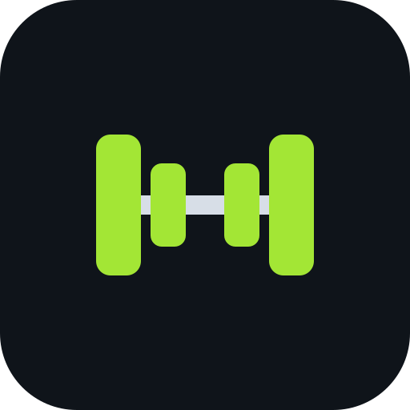
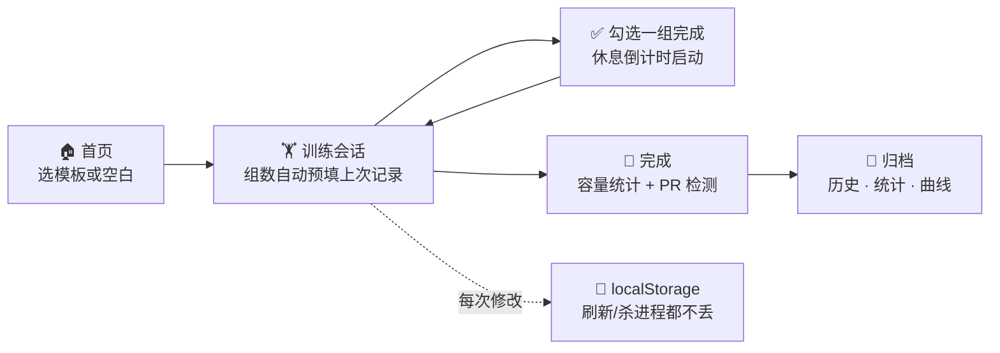

<div align="center">



# GymGym

**纯本地的健身与体重记录 PWA —— 记下每一组、休息计时内置、PR 自动检测。零后端零账号：数据永远不离开你的手机。**

[](https://mocas-12.github.io/gym-gym/)
[](https://react.dev)
[](https://github.com/pmndrs/zustand)
[](https://vitejs.dev)
[](https://mocas-12.github.io/gym-gym/)
[](./LICENSE)

**[🌐 在线使用 (GitHub Pages)](https://mocas-12.github.io/gym-gym/)**

[English](./README.md) | **简体中文**

*Safari → 分享 → 添加到主屏幕 → 全屏 app → 开始训练*

</div>

---

## 📖 目录

- [功能](#-功能)
- [UI 设计](#-ui-设计)
- [工作原理](#-工作原理)
- [项目结构](#-项目结构)
- [快速开始](#-快速开始)
- [iPhone 安装](#-iphone-安装)
- [Apple Watch 路线图](#-apple-watch-路线图)
- [测试](#-测试)
- [常见问题](#-常见问题)
- [隐私与安全](#-隐私与安全)
- [许可证](#-许可证)

## ✨ 功能

- 📅 **周计划 / 顺序轮换**：按星期几排课，或不看星期直接轮换（推→拉→腿→推…），首页显示今天练什么；休息日告诉你下一次是什么时候
- 📈 **渐进规则引擎**：线性和双进程两种方案自动加重——做满目标次数 → 加重；没做满 → 不加；连续停滞 → 减载。每个目标都注明「为什么是这个数」（openGym 的灵魂功能，纯函数重写）
- 🔗 **超级组**：模板编辑器里把相邻动作配成一对，训练时高亮分组、休息倒计时提醒你交替做
- 👆 **滑动操作**：一组左滑删除、右滑复制；训练页每个动作可独立改休息时长
- 🏋️ **引导式训练**：从预设模板（推日/拉日/腿日/全身）或空白训练开始，内置 115 个动作覆盖 8 大肌群 × 5 类器械，支持器械筛选和搜索，还能一键创建自定义动作
- 📋 **重量自动带出**：每个动作自动预填你上次练的组数、次数和重量，不用从零输入（思路来自 openGym）
- ⏱️ **休息计时**：勾选一组完成即启动倒计时，悬浮在所有页面之上；时间到蜂鸣（WebAudio）+ 震动，支持 +30s 和跳过
- ☀️ **屏幕常亮**：训练进行中通过 Wake Lock API 保持屏幕不熄灭
- 🏆 **PR 检测**：收尾时按 Epley 公式估算每个动作的 1RM 与历史对比，超越历史最佳才标记 🎉——第一次练的动作只建立基线
- ⚖️ **体重记录**：每日打卡，首页迷你曲线 + 历史页完整曲线
- 📊 **历史统计**：每动作估计 1RM 曲线、近一年 GitHub 风格训练热力图、肌群恢复条（大肌群 72h / 小肌群 48h）、本月次数/容量、每动作最佳、可展开查看每一组的训练记录
- 💾 **一键备份**：全部数据导出为单个 JSON 文件，任何设备可导入恢复
- 🈶 **中文优先界面**，深色 iOS 风格主题
- 🔒 **纯本地**：无后端、无账号、无遥测——全部状态就是 `localStorage` 里的一份 JSON 文档

## 🎨 UI 设计

| 元素 | 设计 |
| --- | --- |
| 主题 | 近黑蓝底（`#0c1015`）+ 荧光绿强调色（`#a3e635`），iOS 系统质感 |
| 卡片 | 深色面板 + 细边框，16px 圆角 |
| 标签栏 | 底部固定，毛玻璃模糊，刘海屏安全区适配 |
| 休息条 | 悬浮于标签栏上方的渐变条，等宽数字倒计时 |
| 动作抽屉 | 底部抽屉按肌群分组，支持搜索和一键创建自定义动作 |
| 字体 | `-apple-system` 字体栈，所有数字使用等宽数字（tabular-nums） |

## 🧠 工作原理



1. **单一 store**：一个 Zustand store 装下全部应用状态（`useStore.js`），经 `zustand/middleware` 持久化到 `localStorage`。进行中的训练放在同一份文档里，刷新或强杀进程都不会丢组
2. **组数预填**：`lib/workout.js → prefillFor()` 从历史中倒查该动作最近一次的组数安排，复制为本组建议值
3. **休息计时**：倒计时存的是时间戳而非递减计数器，重渲染后依然准确；结束时通过 WebAudio 蜂鸣并调用 `navigator.vibrate` 震动
4. **PR 规则**：`lib/onerm.js` 对每组计算 Epley 估算 1RM；只有「曾有过记录且这次更好」才记 PR——新动作的第一次只建立基线
5. **零依赖图标**：`scripts/gen-icons.mjs` 手写 PNG 编码（IHDR/IDAT/IEND + zlib），全项目不依赖任何 canvas 或图像库
6. **部署**：`npm run deploy` 构建后用临时 `GIT_INDEX_FILE` 把 `dist/` 作为孤儿提交推到 `gh-pages`，GitHub Pages 直接伺服

## 📁 项目结构

```text
gym-gym/
├── index.html               # iOS meta：独立 app 模式、状态栏样式、安全区 viewport
├── logo.svg                 # 仓库 logo（也是应用图标的设计稿）
├── public/
│   ├── manifest.webmanifest # PWA manifest（standalone、竖屏、zh-CN）
│   └── icons/               # 生成的 PNG：192 / 512 / apple-touch 180
├── scripts/
│   ├── gen-icons.mjs        # 纯 Node PNG 编码器 → 应用图标
│   └── deploy.mjs           # 构建 + 把 dist/ 孤儿提交推到 gh-pages
├── src/
│   ├── main.jsx / App.jsx   # hash 路由标签页：首页 / 训练 / 历史 / 设置
│   ├── store/
│   │   ├── useStore.js      # 唯一的 store：全部数据 + 操作，持久化
│   │   └── useUI.js         # 易失 UI：休息倒计时、toast、蜂鸣与震动
│   ├── data/
│   │   ├── exercises.js     # 46 个内置动作（肌群 / 器械 / 次数-计时）
│   │   └── routines.js      # 预设模板：推日 / 拉日 / 腿日 / 全身
│   ├── lib/                 # 纯领域逻辑，每个文件配单测
│   │   ├── onerm.js         # Epley 估算 1RM
│   │   ├── workout.js       # 收尾归档 / 容量 / PR 判定 / 组数预填
│   │   └── *.test.js
│   ├── components/          # TabBar / RestTimer / ExercisePicker
│   └── views/               # Home / WorkoutView / HistoryView / SettingsView
└── smoke.mjs                # Playwright 端到端冒烟（本地预览或线上 URL）
```

## 🚀 快速开始

```bash
git clone https://github.com/Mocas-12/gym-gym.git
cd gym-gym
npm install
npm run dev
# 打开 http://localhost:5173/
```

| 命令 | 说明 |
| --- | --- |
| `npm run dev` | Vite 开发服务器，热更新 |
| `npm test` | Vitest 单测（1RM、容量、PR 规则、预填） |
| `npm run smoke` | Playwright 端到端冒烟（先 `npm run build && npm run preview`） |
| `npm run build` | 生产构建到 `dist/` |
| `npm run icons` | 按 logo 几何重新生成应用图标 |
| `npm run deploy` | 构建 + 发布到 GitHub Pages（gh-pages 分支） |

> 刻意不依赖 CI：`npm run deploy` 把 `dist/` 以孤儿提交推到 `gh-pages` 分支（Pages 源指向它），每次改完跑一下线上即更新。

## 📱 iPhone 安装

1. 用 Safari 打开[线上地址](https://mocas-12.github.io/gym-gym/)
2. 点 **分享 → 添加到主屏幕**
3. 从主屏幕打开——全屏运行，和原生 app 没区别

数据存在这个主屏幕 app 自己的 `localStorage` 里，iOS **不会**对它执行普通网页标签页的「7 天不用即清除」策略。尽管如此，还是建议偶尔在设置里导出一份 JSON 备份——只要两下点击。

## 🍎 Apple Watch 路线图

| 阶段 | 能力 | 前提 |
| --- | --- | --- |
| 现在 | 训练/休息提醒以 iOS 通知的形式镜像到手表 | 需要先接入一个小的 Web Push 后端 |
| 以后 | 原生 watchOS app（手表上独立计时与记录） | Mac + Xcode，或 GitHub Actions macOS runner 构建 + Windows 上 Sideloadly 签名（7 天一续） |

数据模型刻意保持「单个 JSON 文档」，未来任何后端或手表 app 都能直接采用，无需迁移。

## 🧪 测试

领域逻辑全部是纯函数，测试文件就放在代码旁边；另有 Playwright 冒烟脚本走完整用户流程。本地运行：

```bash
npm test     # 7 个单测：1RM 数学、容量、PR 规则、预填
npm run smoke
```

冒烟脚本以 390×844（iPhone）视口驱动完整流程：渲染首页 → 模板开练 → 勾选一组（休息条出现）→ 抽屉加动作 → 完成训练 → 校验历史——出现任何控制台或页面错误即失败。

## ❓ 常见问题

<details>
<summary><b>换手机数据会丢吗？</b></summary>

- 先导出就不会：设置 → <b>导出备份</b> 生成一份包含全部数据的 JSON，新设备上导入即可。没有账号意味着没有自动同步——这正是零服务器方案的取舍
</details>

<details>
<summary><b>iOS 会清掉存储的数据吗？</b></summary>

- 普通 Safari 标签页 7 天不用可能被系统清除，但添加到主屏幕的 PWA 不受此限制。不过导出按钮就在那儿——用就是了
</details>

<details>
<summary><b>为什么没有云同步/账号？</b></summary>

- 刻意为之：这个项目的意义就在于零服务器、零注册。数据模型（每用户一份 JSON 文档）保持极简，正是为了将来想加同步后端时——基于修订号、字段级合并、openGym 那套——什么都不用迁移
</details>

<details>
<summary><b>安卓或电脑上能用吗？</b></summary>

- 能，任何现代浏览器都行。布局以 iPhone 尺寸优先，桌面端标签栏居中、内容列限宽 560px
</details>

<details>
<summary><b>计时类动作（平板支撑、有氧）怎么记？</b></summary>

- 标记为 <code>type: time</code> 的动作复用同一行输入：重量列填秒数、次数列填速度/配速。PR 检测会自动跳过它们（没有有意义的 1RM）
</details>

## 🔒 隐私与安全

- 🏋️ 全部数据存在你浏览器的 `localStorage` —— **从不上传、不经过任何服务器**
- 🚫 应用运行时**零网络请求**：无统计、无 CDN 调用、无账号、无追踪
- 📦 备份是你自己手动导出的 JSON 文件，保存在你自己手里
- 🔑 没有注册、没有登录、因此也没有可泄露的东西

## 📄 许可证

本项目基于 [MIT](./LICENSE) 协议开源——可自由使用、修改、再分发（含商用），只需保留版权与许可声明。

---

<div align="center">

**GymGym** · local-first，架构思路致敬 [openGym](https://github.com/DuarteSantos8/openGym)

</div>
